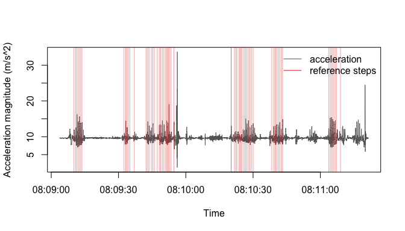
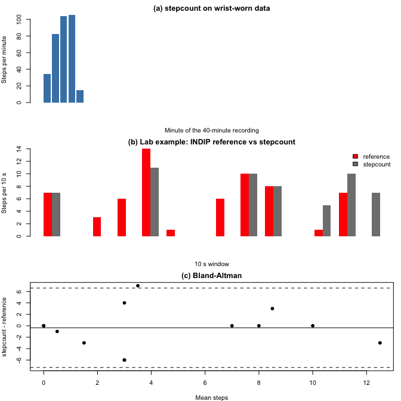

<!-- README.md is generated from README.Rmd. Please edit that file -->

# mobgap

<!-- badges: start -->

[](https://github.com/jhuwit/mobgap/actions/workflows/R-CMD-check.yaml)
[](https://app.codecov.io/gh/jhuwit/mobgap)
[](https://CRAN.R-project.org/package=mobgap)
<!-- badges: end -->

R/`reticulate` wrapper for the
[mobgap](https://github.com/mobilise-d/mobgap) Python module (Mobilise-D
gait analysis). It loads Mobilise-D datasets and returns reference
walking bouts, steps, strides, turns and raw IMU data as R data frames.

## Installation

``` r
# install.packages("remotes")
remotes::install_github("jhuwit/mobgap")
```

The Python `mobgap` module is installed automatically by `reticulate`
(`py_require()` is called in `.onLoad`). Temporary `uv` lock files left
over from that setup can be removed with `mobgap_cleanup_uv()`.

## Usage

Python:

``` python
from mobgap.data import TVSFreeLivingDataset
ds = TVSFreeLivingDataset(path, reference_system="INDIP",
                          missing_reference_error_type="skip")
for dp in ds:
    ref = dp.reference_parameters_
    steps_per_wb = ref.ic_list.groupby("wb_id").size()
    total_steps = len(ref.ic_list)
```

R (shown here with the example laboratory data):

``` r
library(mobgap)
ds = mobgap_dataset(type = "example_lab", reference_system = "INDIP")
# free-living: mobgap_dataset(path, type = "free_living", reference_system = "INDIP",
#                             missing_reference_error_type = "skip")
dp = mobgap_datapoints(ds)[[3]]
ref = mobgap_reference(dp)
ref$wb_list[, c("wb_id", "start", "end", "n_strides", "avg_cadence_spm")]
#>   wb_id start   end n_strides avg_cadence_spm
#> 1     0   632   988         5       104.06908
#> 2     1  2864  3325         4        81.29648
#> 3     2  3853  5085        16        89.24633
#> 4     3  7641  8621        12        94.37032
#> 5     4  9451  9932         6        88.77870
#> 6     5 11989 12517         6        95.83269
mobgap_steps_per_wb(ref)
#>   wb_id n_steps
#> 1     0       7
#> 2     1       6
#> 3     2      18
#> 4     3      16
#> 5     4       8
#> 6     5       8
mobgap_total_steps(ref)
#> [1] 63
mobgap_reference_summary(ds)$totals
#>   cohort participant_id time_measure   test  trial n_wb total_steps
#> 1     HA            001 TimeMeasure1  Test5 Trial1    1           9
#> 2     HA            001 TimeMeasure1  Test5 Trial2    1           9
#> 3     HA            001 TimeMeasure1 Test11 Trial1    6          63
#> 4     HA            002 TimeMeasure1  Test5 Trial1    0           0
#> 5     HA            002 TimeMeasure1  Test5 Trial2    0           0
#> 6     HA            002 TimeMeasure1 Test11 Trial1    3          46
#> 7     MS            001 TimeMeasure1  Test5 Trial1    1           9
#> 8     MS            001 TimeMeasure1  Test5 Trial2    1           9
#> 9     MS            001 TimeMeasure1 Test11 Trial1    6          91
```

## Raw accelerometry and step counts

``` r
imu = mobgap_imu_data(dp, position = "LowerBack")
steps = mobgap_step_times(dp, ref)
imu$mag = sqrt(imu$acc_x^2 + imu$acc_y^2 + imu$acc_z^2)
plot(imu$time, imu$mag, type = "l", col = "grey40",
     xlab = "Time", ylab = "Acceleration magnitude (m/s^2)")
abline(v = steps$time, col = adjustcolor("red", 0.4))
legend("topright", legend = c("acceleration", "reference steps"),
       col = c("grey40", "red"), lty = 1, bty = "n")
```



``` r
mobgap_steps_by_interval(steps, "min")
#>                  time n_steps
#> 1 2020-12-10 13:09:00      31
#> 2 2020-12-10 13:10:00      24
#> 3 2020-12-10 13:11:00       8
```

## Comparing with `stepcount` (wrist-worn data)

[`stepcount`](https://github.com/jhuwit/stepcount) estimates steps from
accelerometry. `mobgap_to_acc()` reshapes `mobgap` raw data (m/s^2) into
the `time`/`x`/`y`/`z` (g) format it expects, and
`mobgap_compare_steps()` computes agreement with the reference steps.

``` r
acc = mobgap_to_acc(mobgap_imu_data(dp, "LowerBack"))   # keeps attr "sample_rate"
sc  = stepcount::stepcount(acc, sample_rate = attr(acc, "sample_rate"))
mobgap_compare_steps(mobgap_step_times(dp), sc$steps, interval = 10,
                     origin = sc$steps$time[1])
```

Python note: `stepcount` pins `pandas==2.0.*` while `mobgap`/`multigait`
need newer pandas, so run them in separate R sessions. The results below
were precomputed by `data-raw/stepcount-example.R` and stored in
`inst/extdata/stepcount_example.rds`: (a) `stepcount` on the 40-minute
wrist-worn recording `multigait::wrist_imu`, and (b, c) `stepcount`
against the INDIP reference for the lower-back lab example (a rough
check, since the models are trained on wrist data).

``` r
ex = readRDS(system.file("extdata/stepcount_example.rds", package = "mobgap"))
wrist = ex$wrist_stepcount
cmp = mobgap_compare_steps(
  data.frame(time = ex$lab_reference$time, n_steps = 1), ex$lab_stepcount,
  interval = 10, origin = ex$lab_stepcount$time[1]
)
op = par(mfrow = c(3, 1), mar = c(4, 4, 2, 1))
per_min = tapply(wrist$steps, floor(as.numeric(wrist$time) / 60) * 60, sum)
barplot(per_min, col = "steelblue", border = NA, names.arg = NA,
        main = "(a) stepcount on wrist-worn data", ylab = "Steps per minute",
        xlab = "Minute of the 40-minute recording")
barplot(rbind(cmp$data$reference, cmp$data$estimate), beside = TRUE,
        col = c("red", "grey50"), border = NA,
        main = "(b) Lab example: INDIP reference vs stepcount",
        ylab = "Steps per 10 s", xlab = "10 s window")
legend("topright", c("reference", "stepcount"), fill = c("red", "grey50"),
       bty = "n")
plot(cmp$data$mean, cmp$data$difference, pch = 19,
     ylim = range(c(cmp$data$difference, cmp$summary$loa_lower, cmp$summary$loa_upper)),
     main = "(c) Bland-Altman", xlab = "Mean steps", ylab = "stepcount - reference")
abline(h = c(cmp$summary$bias, cmp$summary$loa_lower, cmp$summary$loa_upper),
       lty = c(1, 2, 2))
```



``` r
par(op)
round(cmp$summary, 2)
#>   total_reference total_estimate  bias  mae rmse  mape correlation loa_lower
#> 1              63             58 -0.36 2.36 3.43 86.43        0.69      -7.3
#>   loa_upper
#> 1      6.59
```

## Getting the Mobilise-D TVS data (wrist and steps)

The full dataset is on Zenodo, [record
15861907](https://zenodo.org/records/15861907)
([doi:10.5281/zenodo.15861907](https://doi.org/10.5281/zenodo.15861907)),
version 1.0.2, licensed **CC-BY-NC-ND 4.0** (check that your use
complies). It is one zip per cohort (HA, MS, PFF, PD, COPD, CHF), each
**7-11 GB** (about 58 GB in total), so start with one cohort and check
your disk space (zip plus unzipped).

``` r
mobgap_tvs_cohorts()                      # files, sizes, MD5 checksums

# downloads, verifies the MD5, unzips; returns the folder to use as `path`
path = mobgap_tvs_download("~/mobgap_tvs", cohorts = "HA")
```

This creates
`path/<cohort>/<participant>/{Laboratory,Free-living}/data.mat`, which
is the layout `mobgap`’s TVS datasets read. Interrupted downloads can be
resumed by calling the function again (valid zips are reused). If you
download the zips by hand from Zenodo, unzip every cohort into one
folder and use that folder as `path`.

Then load the wrist sensor with reference steps. A participant wears the
unit on one wrist, so run each side and combine:

``` r
ds = mobgap_wrist_dataset(path, type = "lab", side = "left")      # or "free_living", "right"
dp = mobgap_datapoints(ds)[[1]]
x = mobgap_wrist_steps(dp)
x$imu       # raw wrist acceleration (m/s^2); attr(x$imu, "sample_rate") is 100
x$steps     # reference steps (initial contacts) with clock times
x$wb_list   # walking bouts
```

Example output for one healthy-adult laboratory recording (simulated
daily activities, left wrist):

    sample_rate: 100   n_samples: 25784   n_steps: 32
    mobgap_gravity_means(x$imu[, c("acc_x", "acc_y", "acc_z")])
    #> acc_x acc_y acc_z
    #>  7.85 -3.61 -2.51

`participant_information.xlsx` is not part of the zips; it is only
needed for `mobgap`’s participant-information properties, not for raw
data or steps.

## Sensor axes and orientation

Step-counting and gait models that read the raw `x`/`y`/`z` channels are
generally **not rotation invariant**: the same movement looks different
if the device axes, strap rotation or body side differ from the training
data. Check orientation before applying a model to a new device.

``` r
imu = mobgap_imu_data(dp, position = "LowerBack")
mobgap_gravity_means(imu)                  # gravity should sit mostly on one axis
#>      acc_x      acc_y      acc_z 
#>  9.0425935 -0.9496152 -2.2943359
R = rbind(c(0, 0, -1), c(1, 0, 0), c(0, -1, 0))   # new x = -old z, y = old x, z = -old y
round(mobgap_gravity_means(mobgap_rotate_acc(imu, R)), 2)
#> acc_x acc_y acc_z 
#>  2.29  9.04  0.95
length(mobgap_axis_rotations())            # the 24 proper axis rotations
#> [1] 24
```

Units: `mobgap` returns accelerometer data in m/s^2 (the Mobilise-D
`.mat` files store g); `mobgap_to_acc()` converts back to g.

### Where wrist data and step references exist

`mobgap`’s bundled example data (`LabExampleDataset`) has only the lower
back plus INDIP feet, **no wrist**. Wrist data are in the full
Mobilise-D Technical Validation Study (TVS; see below): version 1.0.2
added an INDIP IMU on the **left or right wrist** (each participant wore
one) for all participants except CHF5084, CHF5086 and CHF5089, with
INDIP initial contacts as the step reference for both laboratory and
free-living recordings.

The notes below on the smaller INDIP sample release ([Zenodo
7802795](https://zenodo.org/records/7802795), CC-BY 4.0; one
healthy-adult in-lab recording with a right wrist) come from an external
analysis and were not re-verified here. The protocol paper (Mazza et
al., *BMJ Open* 2021;11:e050785) defines a device frame for the
lower-back unit only and gives **no axis definition for the wrist
module**, so what the wrist `x` means in other conventions can’t be
established from it.

### What an orientation check found (and what it does not show)

| Observation | Status |
|----|----|
| A step model run on the raw wrist channels undercounted by 31% (124 vs 180 steps) and by 52% on the short walking tests. | verified on one recording |
| One of the 24 rotations (new x = -old z, new y = +old x, new z = -old y) gave 179 steps (-0.4% bias, 7.2% per-recording MAPE). | verified, but chosen using the answers |
| In this recording gravity lies almost entirely on `x` (about +1 g) while training sets put it on other axes. | verified |
| The undercount is caused by an axis mismatch. | **inferred, not proven**: strap rotation, forearm placement and the right wrist are confounded |

The best rotation was selected on the same data it was scored on, from
24 candidates, for one person with 180 steps. **Do not quote 7.2% as
accuracy, and do not reuse that rotation without validating on
independent participants.** Prefer rotation-invariant inputs such as
vector magnitude, or models trained across rotations, and validate on
more wrist-plus-step participants.

## Troubleshooting Python

- **`llvmlite.binding.initialize() is deprecated` / `RuntimeError` on
  `import mobgap.pipeline`:** `numba` is older than `llvmlite`. Pin
  matching versions, e.g. `pip install "numba>=0.62" "llvmlite>=0.45"`
  or `pip install "llvmlite==0.44.*"` with `numba==0.61.*`.
- **`numba` fails to build (`clang: unsupported option '-fopenmp'`) in
  the managed environment:** on Intel macOS no `numba` wheel exists for
  the chosen Python, so `uv` builds from source. Use a Python with
  wheels (e.g. `RETICULATE_PYTHON` pointing to a conda environment)
  instead.
